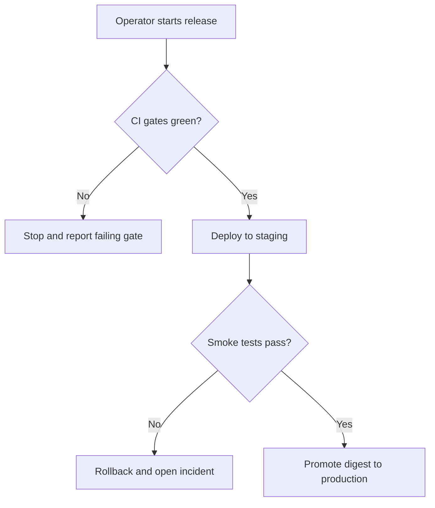
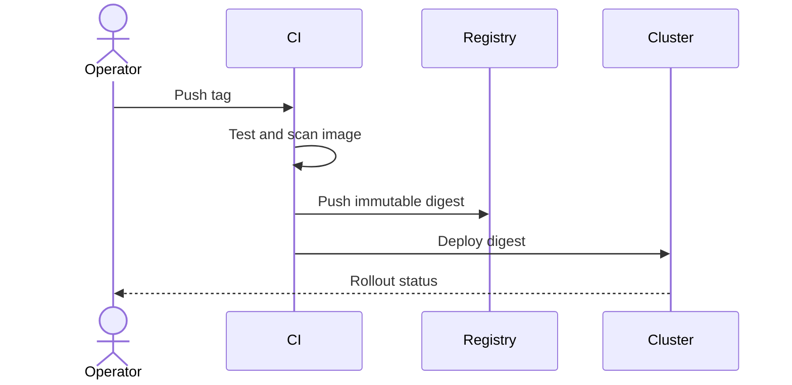
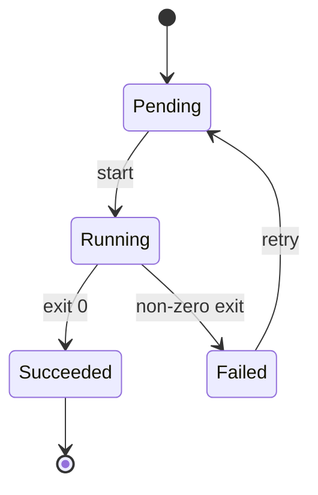

# Process Documentation

## Scope

Use this skill for documents that tell someone how to do something or how a
system behaves over time:

- runbooks, standard operating procedures, and incident response steps
- deployment, release, rollback, and migration procedures
- onboarding guides, checklists, and recurring operational tasks
- test plans, QA procedures, and acceptance walkthroughs
- architecture or process overviews that need flow and relationship diagrams

Write all repository documentation in English. Follow the
`english-artifacts` skill for terminology, naming, and commit messages; this
skill covers structure, Markdown, and diagrams. Communicate with the user in
their language.

## Document structure

Every process document should make these elements findable:

| Element | Content |
|---|---|
| Title | Verb or process name, specific enough to distinguish from siblings |
| Purpose and scope | What the process achieves and what it does not cover |
| Audience and roles | Who executes it and who approves or is informed |
| Prerequisites | Access, tools, versions, data, and prior state |
| Inputs and outputs | What is consumed, produced, and where it goes |
| Steps | Numbered, imperative, one action per step |
| Decision points | Conditions, branches, and who decides |
| Failure handling | Expected errors, rollback, escalation, and safe stop |
| Verification | How the operator confirms success |
| References | Related docs, dashboards, tickets, and source of truth |
| Ownership | Owner, status, last review date, and change history |

Use a short metadata table at the top for owner, status, audience, and last
review date. Keep the document focused: link to detail instead of inlining
everything.

## Markdown standards

Follow GitHub's basic writing and formatting syntax:
<https://docs.github.com/en/get-started/writing-on-github/getting-started-with-writing-and-formatting-on-github/basic-writing-and-formatting-syntax>

Structure:

- One `#` H1 per document; use `##` and `###` in order, never skip levels.
- Keep headings short and scannable; do not use headings as sentences.
- Separate sections with blank lines. GitHub collapses single line breaks, so
  use a blank line or a trailing two spaces, not accidental wrapping.

Text:

- Use `**bold**` for UI labels and key terms on first use, `*italic*` for
  emphasis, and `~~strikethrough~~` only for deprecated content.
- Use inline `code` for commands, paths, identifiers, environment variables,
  and literal values.
- Use fenced code blocks with an explicit language:

  ````markdown
  ```bash
  docker compose up -d --wait
  ```
  ````

- Escape Markdown characters with a backslash when they must render literally.
- Write links as descriptive text, never "click here"; prefer relative links
  for repository files and absolute links for external sources.
- Add descriptive alt text to every image: ``.
- Use tables for parameters, matrices, and comparisons; align columns for
  readability in source.
- Use task lists for checklists: `- [ ]` and `- [x]`.
- Use alerts sparingly and only for actionable warnings:

  ```markdown
  > [!WARNING]
  > This step drops the `pages` table. Back up first.
  ```

  Supported types: `NOTE`, `TIP`, `IMPORTANT`, `WARNING`, `CAUTION`.
- Use `<details><summary>...</summary>` for long logs or optional background.
- Use footnotes for sources that would interrupt the flow: `[^1]`.
- Avoid emoji in operational documents, and never use them to convey state.
- Do not use raw HTML for layout; use Markdown so it renders on GitHub, IDEs,
  and in plain text.

## Writing the steps

- Start each step with an imperative verb: "Run", "Open", "Verify", "Set".
- One action per numbered step. If a step needs sub-actions, use a nested list
  and keep the numbering stable.
- State the expected result after actions that can be verified, for example
  "The command prints `potagia listening on http://127.0.0.1:3000`".
- Name exact commands, paths, versions, and environment variables. Avoid
  "configure the service appropriately".
- Define acronyms on first use and keep one term per concept for the whole
  document.
- Prefer present tense and active voice. Avoid "simply", "just", "obviously",
  and time-relative wording such as "currently" or "soon".
- Make prerequisites and failure handling explicit; an operator should not have
  to infer them.
- Include copy-pasteable commands with placeholders in `UPPER_SNAKE_CASE` and
  document each placeholder.

## Mermaid diagrams

Use Mermaid when a picture replaces a paragraph of relationship or flow
description. Follow the Mermaid introduction and syntax reference:
<https://mermaid.js.org/intro/>

Choose the diagram by question:

| Question | Diagram |
|---|---|
| What happens next, and where does it branch? | `flowchart` |
| Who calls whom, and in what order? | `sequenceDiagram` |
| What states can an entity be in? | `stateDiagram-v2` |
| How do entities relate? | `erDiagram` |
| When do tasks happen? | `gantt` or `timeline` |
| What are the parts and their hierarchy? | `mindmap` or `block` |

Rules:

- Keep each diagram to one idea, roughly 5-15 nodes. Split instead of shrinking
  text.
- Label every edge that is not obvious; use consistent vocabulary with the
  prose.
- Use `subgraph` to group by actor, service, or trust boundary.
- Avoid custom themes, `%%{init}%%` directives, and heavy styling; GitHub may
  ignore them or render differently.
- Do not encode meaning in color alone; the diagram must read in monochrome.
- Add a caption or one-sentence text summary next to the diagram. Mermaid output
  is an SVG without alt text on GitHub, so the prose carries accessibility.
- Prefer a table when the content is a matrix; a diagram adds no value there.

Flowchart:



Sequence:



State:



## Document types

- **Runbook**: symptom, impact, diagnosis, mitigation, rollback, escalation.
  Ordered by what the operator does under pressure, not by system architecture.
- **SOP**: recurring procedure with roles, approvals, and evidence to retain.
- **How-to**: task-oriented steps for a competent reader; assumptions stated.
- **Test plan**: scope, requirements covered, environments, data, cases,
  pass/fail criteria, and reporting.
- **Decision record**: context, decision, alternatives, consequences, status.

## Validation

```bash
npx markdownlint-cli2 "doc/**/*.md"        # structure and formatting
lychee --offline "doc/**/*.md"             # or: lychee doc/ for real links
npx @mermaid-js/mermaid-cli -i diagram.mmd -o diagram.svg   # extracted block
```

- Preview the rendered result on GitHub, not only in the editor; alerts,
  footnotes, and Mermaid depend on the renderer.
- Check that every command was actually run in the documented environment, or
  mark it as unverified.
- Confirm relative links resolve and anchors match their headings.
- Verify the Mermaid blocks render without syntax errors; a broken diagram is a
  broken document.
- Keep the metadata table's owner and last review date current.

## Review checklist

- The document answers who, what, when, where, why, and how.
- Steps are numbered, imperative, and independently verifiable.
- Prerequisites, failure handling, rollback, and escalation are present.
- No secrets, real personal data, internal hostnames, or customer data.
- Terminology matches the codebase and the PRD.
- Diagrams render, are legible at repository width, and have a text summary.
- Links and code fences are valid; language is English and consistent.

## Anti-patterns

- A wall of prose with no headings, steps, or expected results.
- Screenshots of text that should be selectable and searchable.
- Diagrams that duplicate a table or restate the prose without adding relations.
- Documents without owner or review date that silently drift from reality.
- Copy-pasted commands with undeclared placeholders or missing prerequisites.
- Mixing languages or renaming concepts between sections.
