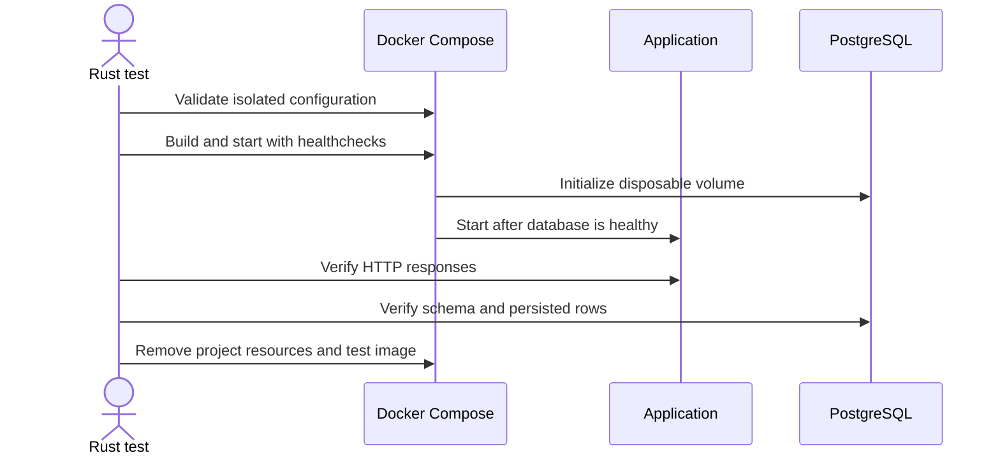

# Run Docker Compose integration tests

| Metadata | Value |
| --- | --- |
| Status | Active |
| Owner | Quality assurance |
| Audience | Developers and quality assurance engineers |
| Last review | 2026-11-14 |

## Purpose and scope

The Compose integration suite verifies the deployed prototype through its real
HTTP and PostgreSQL boundaries. It builds the application image, starts a clean
stack, checks seeded content and schema initialization, and verifies application
restart behavior. It does not verify the draft management-product requirements
in `magia/specifications.md`, browser journeys, accessibility, or performance.

## Prerequisites

- Run on Linux or another Unix host that supports process-group signals.
- Install Rust 1.99.1, matching the application build image.
- Install Docker Engine with Docker Compose v2.24.4 or later. Verify the
  version with `docker compose version`; the override uses the `!override` YAML
  tag introduced in that release.
- Grant the current user access to the Docker daemon.
- Keep port publishing on loopback available; the tests do not use fixed host
  ports.

The suite creates temporary containers, networks, images, secrets, and volumes.
Every test uses a unique project name beginning with `potagia-integration-` and
never uses the development project name `potagia` or its
`potagia_postgres_data` volume.

## Run the suite

1. Run only the Compose integration tests:

   ```bash
   cargo test --test compose_integration --locked -- --nocapture
   ```

   Two independent tests start isolated stacks. Cargo may run them in parallel.

2. Run all Rust tests, including the Compose suite:

   ```bash
   cargo test --all-targets --locked
   ```

   This command requires a working Docker daemon. No test is ignored or
   serialized to hide resource conflicts.

## Test lifecycle



Each stack receives a generated image tag and a synthetic password in a
temporary directory. `tests/compose.integration.yaml` replaces fixed development
ports with ephemeral loopback ports and disables restart loops. Startup uses
bounded Compose healthcheck waits. Restart verification discovers the ephemeral
application port again because Docker can reassign port `0` allocations, then
polls the root endpoint until it returns HTTP 200 or reaches its deadline.
Docker commands run in their
own process groups so a timeout can terminate the CLI and its Compose plugin.
PostgreSQL operations also have client-side timeouts. Daemon-side work already
accepted by Docker can require manual recovery after a terminated CLI command.

Successful test paths call an explicit teardown operation, so a cleanup failure
fails the test. Assertion failures and early error returns invoke a best-effort
Rust cleanup guard while unwinding. Cleanup runs
`docker compose down --volumes --remove-orphans` for the generated project and
attempts to remove its generated application image even if project removal
fails. The pinned PostgreSQL image is not removed. Interrupted processes and
fallback cleanup failures can require the manual recovery described below.

## Failure handling

1. Read the test error and the Compose logs included with startup failures.
2. Check the generated project status if cleanup reports an error:

   ```bash
   docker ps --all \
     --filter label=com.docker.compose.project=POTAGIA_INTEGRATION_PROJECT
   ```

   Replace `POTAGIA_INTEGRATION_PROJECT` with the project name from the failure
   message.

3. Remove only that confirmed disposable project after an interrupted process
   leaves it behind:

   ```bash
   POTAGIA_TEST_IMAGE=POTAGIA_INTEGRATION_PROJECT:local \
   POSTGRES_PASSWORD_FILE=/dev/null \
   docker compose \
     --project-name POTAGIA_INTEGRATION_PROJECT \
     --file compose.yaml \
     --file tests/compose.integration.yaml \
     down --volumes --remove-orphans
   docker image rm POTAGIA_INTEGRATION_PROJECT:local
   ```

4. Stop and investigate rather than retrying a flaky test. The suite contains
   no automatic retries.

## Coverage and limitations

| Observable behavior | Automated check |
| --- | --- |
| Clean startup | Build and wait for both service healthchecks |
| Seeded files | Check exact bytes, status, and media type over HTTP |
| Unknown path | Check an empty `404 Not Found` response |
| Initial database | Query version `1`, three files, and four paths |
| Application restart | Compare metadata and all seeded rows |

There is no `doc/PRD.md` traceability matrix. The draft target specification
explicitly does not describe this prototype, so its product requirements remain
pending rather than covered by these tests.
