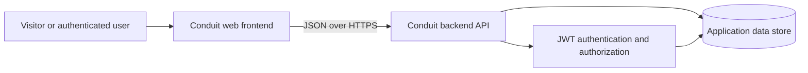
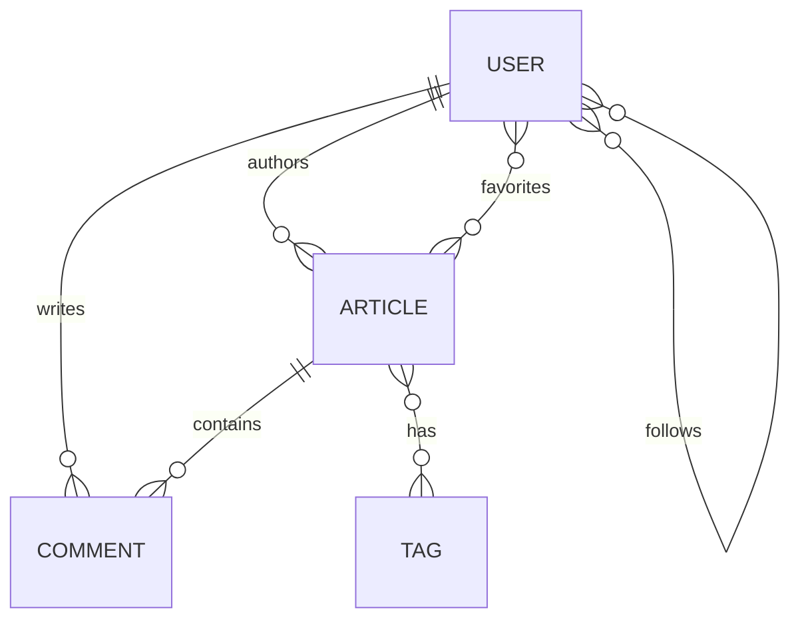

# RealWorld (Conduit) Example Specifications

## Overview

This document specifies an implementation of **Conduit**, the social blogging application defined by the [RealWorld project](https://docs.realworld.show/). Conduit is a Medium.com-style application in which users publish Markdown articles, follow other users, favorite articles, and write comments.

The example consists of a web frontend and a JSON backend API. Either part can be implemented independently and combined with any other implementation that follows the same API contract.

The official [OpenAPI specification](https://github.com/realworld-apps/realworld/blob/main/specs/api/openapi.yml), [API test suite](https://github.com/realworld-apps/realworld/tree/main/specs/api), and [frontend E2E test suite](https://github.com/realworld-apps/realworld/tree/main/specs/e2e) are the authoritative contracts. If this summary or the official prose differs from those tests, the tests take precedence.

## Scope

### Included

- User registration, login, logout, and settings.
- Public user profiles and follow relationships.
- Article creation, reading, updating, and deletion.
- Global, personalized, filtered, and paginated article lists.
- Article favorites.
- Article comments, including creation and deletion.
- Markdown article rendering.
- A shared visual theme and the official frontend routes.
- A JSON API compatible with other RealWorld implementations.

### Excluded

- User account deletion.
- Comment editing.
- Native mobile applications.
- A required programming language, framework, database, or deployment platform.
- The content-visibility restrictions specific to the hosted demo API; those restrictions are not general application requirements.

## Architecture

The frontend renders the routes and calls the backend under the `/api` prefix. The backend authenticates protected requests with a JSON Web Token (JWT), enforces ownership rules, and persists application state. The diagram shows logical responsibilities rather than a required physical deployment.



A frontend-only implementation can use the public demo API at `https://api.realworld.show/api`. The hosted demo limits visible content: logged-out users see demo-account content, while logged-in users see their own content and demo-account content.

## Actors and permissions

| Actor | Capabilities |
| --- | --- |
| Visitor | Register, log in, read articles and comments, browse profiles, list tags, and filter or paginate public article lists. |
| Authenticated user | All visitor capabilities, plus manage their settings, publish articles, comment, favorite articles, follow users, and view their personal feed. |
| Article author | Update and delete their own articles. |
| Comment author | Delete their own comments. |

The backend must enforce permissions even when the frontend hides unavailable controls.

## Functional requirements

### Authentication and user settings

| ID | Requirement |
| --- | --- |
| AUTH-01 | Register a user with a unique username, a unique valid email address, and a password. Return the authenticated user, including a JWT. |
| AUTH-02 | Log in with an email address and password. Return the authenticated user, including a JWT. |
| AUTH-03 | Send the JWT as `Authorization: Token JWT_VALUE` on protected API requests. |
| AUTH-04 | Store the frontend JWT in `localStorage` using the key required by the official selectors contract. An implementation may use session or cookie authentication when it is not targeting that browser contract. |
| AUTH-05 | Retrieve and update the current user's email, username, password, biography, and profile image URL. |
| AUTH-06 | Log out from the settings page by removing the local authentication state and returning the navigation to its logged-out state. |
| AUTH-07 | Do not require account deletion. |

### Profiles and follows

| ID | Requirement |
| --- | --- |
| PROFILE-01 | Display a profile's username, biography, image, and whether the current user follows that profile. |
| PROFILE-02 | Allow an authenticated user to follow and unfollow another user by username. |
| PROFILE-03 | Display a default avatar when a user has no profile image. |
| PROFILE-04 | On a profile, list either articles written by that user or articles favorited by that user. |
| PROFILE-05 | Show profile settings controls for the current user's own profile and follow controls for other profiles. |

### Articles and tags

| ID | Requirement |
| --- | --- |
| ARTICLE-01 | Create an article with a required title, description, and body, and an optional list of tags. |
| ARTICLE-02 | Assign every article a unique slug suitable for retrieving, updating, and deleting it. Duplicate titles must produce distinct slugs; no particular slug format is required. |
| ARTICLE-03 | Update an article's title, description, body, or tag list. When its title changes, update its slug. |
| ARTICLE-04 | Allow only the article's author to update or delete it. |
| ARTICLE-05 | Render the article body as Markdown in the browser without allowing injected script execution. |
| ARTICLE-06 | Display article metadata, including author, timestamps, tags, favorite state, and favorite count. |
| ARTICLE-07 | List articles in most-recent-first order. |
| ARTICLE-08 | Filter the global article list by tag, author username, or favoriting username. |
| ARTICLE-09 | Paginate article lists with `limit` and `offset`. The default limit is 20 and the default offset is 0. |
| ARTICLE-10 | Provide an authenticated personal feed containing recent articles by users the current user follows. |
| ARTICLE-11 | Return article list items without the article `body`; return the body when retrieving one article. |
| ARTICLE-12 | Return the list of available tags for the home-page sidebar. |

### Favorites and comments

| ID | Requirement |
| --- | --- |
| SOCIAL-01 | Allow an authenticated user to favorite and unfavorite an article. |
| SOCIAL-02 | Return the updated favorite state and favorite count after either operation. |
| SOCIAL-03 | Add a comment to an article with a required body. |
| SOCIAL-04 | List an article's comments with their authors and timestamps. |
| SOCIAL-05 | Allow only a comment's author to delete it. Comment editing is not required. |
| SOCIAL-06 | Show article deletion controls only to the article author and comment deletion controls only to the comment author. |

## Frontend specification

### Routes and pages

| Route | Page and required behavior |
| --- | --- |
| `/` | Home page with popular tags, paginated article previews, a **Global Feed** tab, an optional tag tab after selecting a tag, and a **Your Feed** tab for authenticated users. |
| `/login` | Sign-in form with email and password, a link to registration, and validation error display. |
| `/register` | Registration form with username, email, and password, a link to sign in, and validation error display. |
| `/settings` | Current-user form for image URL, username, biography, email, and new password, plus update and logout actions. |
| `/editor` | New-article form with title, description, Markdown body, and tags. |
| `/editor/:slug` | Edit form populated with the article identified by `slug`; available only to its author. |
| `/article/:slug` | Full Markdown article, author metadata, follow and favorite actions, author edit/delete controls, and the comments section. |
| `/profile/:username` | Profile information, follow or settings action, and that user's authored articles. |
| `/profile/:username/favorites` | The same profile with articles favorited by that user. |

The header for visitors contains **Home**, **Sign in**, and **Sign up**. The header for authenticated users contains **Home**, **New Article**, **Settings**, and a link to their profile. Apply the `active` CSS class to the active navigation link. Include the shared Conduit footer.

Article previews link to the full article and show the author, creation date, title, description, tags, favorite control, and favorite count. Lists provide pagination controls and an appropriate empty state when no articles match.

### Templates and styling

- Use the official [Conduit `styles.css`](https://github.com/realworld-apps/realworld/blob/main/assets/theme/styles.css) and the classes defined by the official templates and selectors contract.
- Load the theme's fonts separately: **Source Sans Pro** for body text and **Lora** for headings and article text.
- Load an icon stylesheet compatible with the templates' legacy Ionicons v2 `ion-*` classes, or use equivalent icons.
- Use the official [default avatar](https://github.com/realworld-apps/realworld/blob/main/assets/media/default-avatar.svg) when the profile image is absent.
- Use the official [HTML templates](https://docs.realworld.show/specifications/frontend/templates/) as the layout reference.
- Follow the [E2E selectors contract](https://github.com/realworld-apps/realworld/blob/main/specs/e2e/SELECTORS.md) for input names, CSS classes, visible labels, routes, the JWT storage key, and the `window.__conduit_debug__` interface when running the shared browser tests.

## Backend API specification

### General conventions

- Expose all endpoints beneath `/api`.
- Accept JSON request bodies and return JSON responses with `Content-Type: application/json; charset=utf-8`.
- Authenticate protected endpoints with `Authorization: Token JWT_VALUE`.
- Treat authentication as optional where indicated so that response fields such as `favorited` and `following` reflect the current user when a valid token is supplied.
- Return no response body for successful `204` operations.
- If the frontend and backend use different origins, handle `OPTIONS` preflight requests and return suitable `Access-Control-Allow-Origin` and `Access-Control-Allow-Headers` values, including support for `Content-Type` and the authorization header as needed.

### Endpoints

Authentication values are **No**, **Optional**, or **Required**.

| Method and path | Authentication | Success | Purpose |
| --- | --- | --- | --- |
| `POST /api/users/login` | No | `200` | Log in and return a user. |
| `POST /api/users` | No | `201` | Register and return a user. |
| `GET /api/user` | Required | `200` | Return the current user. |
| `PUT /api/user` | Required | `200` | Update and return the current user. |
| `GET /api/profiles/:username` | Optional | `200` | Return a profile. |
| `POST /api/profiles/:username/follow` | Required | `200` | Follow a user and return the profile. |
| `DELETE /api/profiles/:username/follow` | Required | `200` | Unfollow a user and return the profile. |
| `GET /api/articles` | Optional | `200` | Return a filtered, paginated global article list. |
| `GET /api/articles/feed` | Required | `200` | Return a paginated feed from followed users. |
| `GET /api/articles/:slug` | No | `200` | Return one complete article. |
| `POST /api/articles` | Required | `201` | Create and return an article. |
| `PUT /api/articles/:slug` | Required | `200` | Update and return an article owned by the current user. |
| `DELETE /api/articles/:slug` | Required | `204` | Delete an article owned by the current user. |
| `POST /api/articles/:slug/comments` | Required | `201` | Create and return a comment. |
| `GET /api/articles/:slug/comments` | Optional | `200` | Return an article's comments. |
| `DELETE /api/articles/:slug/comments/:id` | Required | `204` | Delete a comment owned by the current user. |
| `POST /api/articles/:slug/favorite` | Required | `200` | Favorite and return the article. |
| `DELETE /api/articles/:slug/favorite` | Required | `200` | Unfavorite and return the article. |
| `GET /api/tags` | No | `200` | Return the tag list. |

### Request bodies

Every request body has one top-level wrapper named `user`, `article`, or `comment`, as shown below.

| Operation | Wrapper | Required fields | Optional fields |
| --- | --- | --- | --- |
| Login | `user` | `email`, `password` | None |
| Registration | `user` | `username`, `email`, `password` | None |
| Update user | `user` | At least one accepted field | `email`, `username`, `password`, `bio`, `image` |
| Create article | `article` | `title`, `description`, `body` | `tagList` |
| Update article | `article` | None; supply the fields to update | `title`, `description`, `body`, `tagList` |
| Create comment | `comment` | `body` | None |

Email values must use a valid email format. `tagList` is an array of strings. `bio` and `image` accept strings or `null` in user responses and updates.

Example registration request:

```json
{
  "user": {
    "username": "new-user",
    "email": "new-user@example.com",
    "password": "YOUR_PASSWORD"
  }
}
```

### Article list queries

`GET /api/articles` accepts the following query parameters:

| Parameter | Type | Default | Meaning |
| --- | --- | --- | --- |
| `tag` | String | None | Include articles with this tag. |
| `author` | String | None | Include articles by this username. |
| `favorited` | String | None | Include articles favorited by this username. |
| `limit` | Integer, minimum 1 | `20` | Maximum number of returned articles. |
| `offset` | Integer, minimum 0 | `0` | Number of matching articles to skip. |

`GET /api/articles/feed` accepts `limit` and `offset` with the same rules. Both list operations return `articles` and `articlesCount`; `articlesCount` represents the result count required by the API contract and drives pagination.

### Response models

| Model | Fields |
| --- | --- |
| Authenticated user | `email`, `token`, `username`, `bio`, `image` inside `user`. |
| Profile | `username`, `bio`, `image`, `following`. |
| Article | `slug`, `title`, `description`, `body`, `tagList`, `createdAt`, `updatedAt`, `favorited`, `favoritesCount`, and an embedded `author` profile. |
| Article list item | All article fields except `body`. |
| Comment | `id`, `createdAt`, `updatedAt`, `body`, and an embedded `author` profile. |
| Article collection | `articles` array and integer `articlesCount`. |
| Comment collection | `comments` array. |
| Tag collection | `tags` string array. |

Single-resource responses wrap the resource in `user`, `profile`, `article`, or `comment`. Timestamps use the JSON `date-time` format. Nullable biography and image values are represented by `null`.

Example article-list response:

```json
{
  "articles": [
    {
      "slug": "example-article",
      "title": "Example article",
      "description": "A short example.",
      "tagList": ["realworld", "example"],
      "createdAt": "2026-01-01T12:00:00.000Z",
      "updatedAt": "2026-01-01T12:00:00.000Z",
      "favorited": false,
      "favoritesCount": 0,
      "author": {
        "username": "new-user",
        "bio": null,
        "image": null,
        "following": false
      }
    }
  ],
  "articlesCount": 1
}
```

### Errors and status codes

Validation failures return HTTP `422` with field-keyed message arrays:

```json
{
  "errors": {
    "body": ["can't be blank"]
  }
}
```

The API tests assert these validation messages:

| Message | Condition |
| --- | --- |
| `can't be blank` | A required field is missing, `null`, or an empty string. |
| `is invalid` | A field has an invalid format, such as a malformed email address. |
| `has already been taken` | A unique username or email already belongs to another user. |

| Status | Meaning |
| --- | --- |
| `401 Unauthorized` | Authentication is required but missing or invalid. |
| `403 Forbidden` | The authenticated user does not have permission to perform the operation. |
| `404 Not Found` | The requested profile, article, comment, or other resource does not exist. |
| `409 Conflict` | Creation conflicts with an existing resource, including duplicate unique values where reported by the OpenAPI contract. |
| `422 Unprocessable Entity` | Request validation fails. |

## Logical data model

The following diagram captures required relationships without prescribing database tables or storage technology. Follow and favorite relationships are many-to-many; articles and comments belong to their authors.



## Cross-cutting requirements

- Keep the implementation functionally complete and robust without unnecessary architectural complexity.
- Enforce uniqueness for usernames, email addresses, and article slugs.
- Never expose password values or password hashes in API responses.
- Protect Markdown rendering and other user-controlled content against cross-site scripting (XSS).
- Keep authorization checks on the backend; conditional frontend controls are not a security boundary.
- Provide a README with an implementation overview and instructions for running it locally.
- Include at least one unit test. Broader automated coverage is encouraged.

## Acceptance scenarios

| ID | Scenario | Expected result |
| --- | --- | --- |
| AC-01 | A visitor registers with valid, unused credentials. | The API returns `201` and a user with a JWT; the frontend enters its authenticated state. |
| AC-02 | A visitor submits an invalid email or duplicate username. | The API returns the documented error status and field-specific messages; the UI displays the errors. |
| AC-03 | A visitor opens the home page. | Global articles, tags, and pagination appear in most-recent-first order. |
| AC-04 | An authenticated user opens **Your Feed**. | Only recent articles from followed authors appear, subject to pagination. |
| AC-05 | An authenticated user publishes a valid article. | The API returns `201`; the article receives a unique slug and opens successfully. |
| AC-06 | Two users publish articles with the same title. | Both articles remain accessible through distinct slugs. |
| AC-07 | A non-author attempts to update or delete an article. | The API rejects the operation with `403`; the frontend does not offer those controls. |
| AC-08 | A user favorites and then unfavorites an article. | The returned state and count update after each operation. |
| AC-09 | A user follows and then unfollows a profile. | The returned `following` value changes, and the personal feed reflects the relationship. |
| AC-10 | An authenticated user adds a comment. | The API returns `201`, and the comment appears with its author and timestamps. |
| AC-11 | A non-author attempts to delete a comment. | The API rejects the operation with `403`; the frontend does not offer the deletion control. |
| AC-12 | A user requests a protected endpoint without a token. | The API returns `401` and does not perform the operation. |
| AC-13 | A client requests an article list. | List items omit `body`; retrieving an individual article includes it. |
| AC-14 | An article contains malicious markup. | Rendering does not execute injected scripts. |

## Verification

1. Run the implementation's unit tests and confirm that at least one unit test is present.
2. Run the official [Hurl API collection](https://github.com/realworld-apps/realworld/tree/main/specs/api/hurl) against the backend and resolve every contract failure.
3. Extend the official [Playwright base configuration](https://github.com/realworld-apps/realworld/blob/main/specs/e2e/playwright.base.ts) with the frontend's `baseURL` and `webServer` settings.
4. Run the shared frontend E2E suite, including authentication, articles, comments, navigation, settings, social features, error handling, and XSS coverage.
5. Verify the acceptance scenarios against the combined frontend and backend.
6. Confirm that another spec-compliant RealWorld frontend or backend can interoperate with the corresponding part of this implementation.

## References

- [RealWorld documentation](https://docs.realworld.show/)
- [Feature list](https://docs.realworld.show/implementation-creation/features/)
- [Implementation expectations](https://docs.realworld.show/implementation-creation/expectations/)
- [Frontend templates](https://docs.realworld.show/specifications/frontend/templates/)
- [Frontend styles](https://docs.realworld.show/specifications/frontend/styles/)
- [Frontend routing](https://docs.realworld.show/specifications/frontend/routing/)
- [Frontend API and demo limitations](https://docs.realworld.show/specifications/frontend/api/)
- [Backend introduction](https://docs.realworld.show/specifications/backend/introduction/)
- [Backend endpoints](https://docs.realworld.show/specifications/backend/endpoints/)
- [API response formats](https://docs.realworld.show/specifications/backend/api-response-format/)
- [CORS requirements](https://docs.realworld.show/specifications/backend/cors/)
- [Error handling](https://docs.realworld.show/specifications/backend/error-handling/)
- [OpenAPI specification](https://github.com/realworld-apps/realworld/blob/main/specs/api/openapi.yml)
- [Frontend E2E selectors contract](https://github.com/realworld-apps/realworld/blob/main/specs/e2e/SELECTORS.md)
