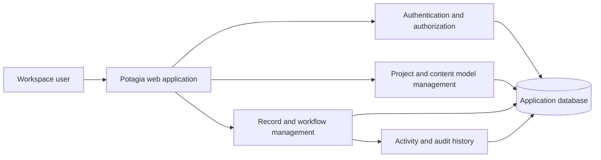
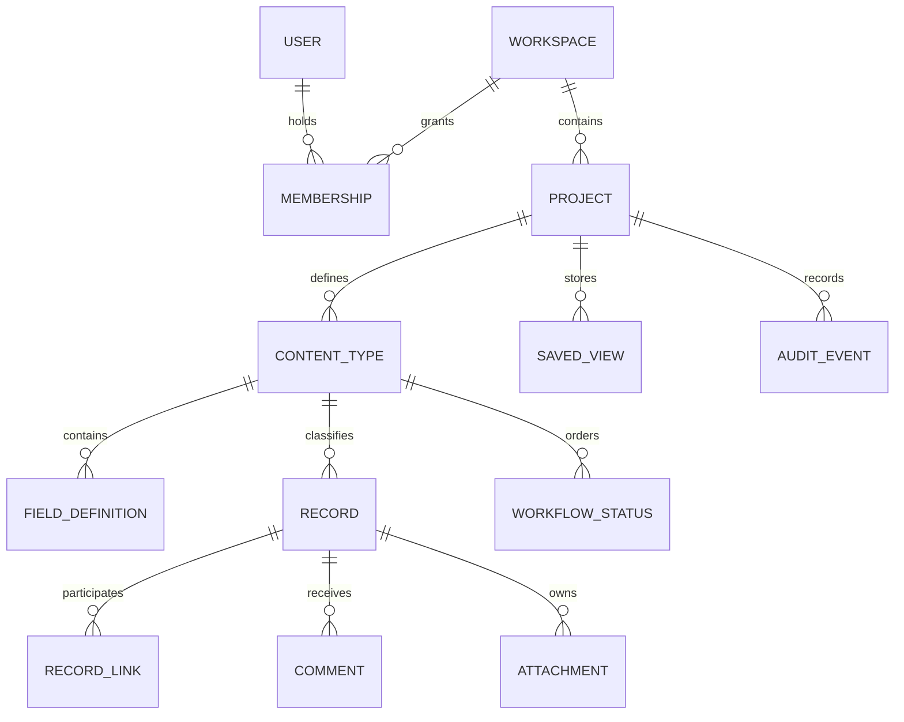

# Potagia Application Specifications

| Metadata | Value |
| --- | --- |
| Status | Draft |
| Version | 0.1 |
| Owner | Product owner to be assigned |
| Audience | Product, user experience, engineering, and quality assurance teams |
| Last review | 2026-11-14 |

## Overview

Potagia is a web application for creating and operating different kinds of management projects from content stored in a database. A management project can represent activities such as task tracking, asset inventory, customer management, event planning, or internal requests without requiring a separate application for each case.

Project administrators define the information structure, relationships, workflows, permissions, and views. Users then create and manage records through interfaces generated from those definitions. Project definitions and project content must be changeable through the application without changing source code or redeploying it.

This document specifies the target product behavior. It does not describe the current prototype, prescribe a programming language or framework, or define a physical database schema. Existing presentation assets are not normative.

## Goals and success criteria

Potagia must meet the following goals:

- Support multiple management domains through configuration rather than domain-specific development.
- Keep project configuration, business content, permissions, and activity history in an authoritative application database.
- Provide a consistent user experience while allowing each project to use its own terminology and data model.
- Enforce workspace isolation and project permissions for every operation.
- Preserve data integrity when models, records, relationships, and workflows change.
- Make common management tasks available through accessible, responsive web interfaces.

The initial release is successful when an administrator can configure two visibly different management projects and authorized users can operate both through the same application without a code change or deployment.

## Scope

### Included

- User authentication and workspace membership.
- Multiple workspaces and multiple management projects per workspace.
- Configurable content types, fields, relationships, and record workflows.
- Record creation, reading, updating, archiving, restoration, and controlled deletion.
- Dynamic forms, record tables, filtering, sorting, searching, and saved views.
- Comments, attachments, and activity history.
- Project-level roles and server-side authorization.
- Comma-separated values (CSV) import and export.
- Audit history for configuration and content changes.
- Responsive and keyboard-accessible web interfaces.

### Excluded from the initial release

- Native mobile applications.
- Arbitrary scripts, custom plug-ins, or user-supplied executable code.
- Direct database access or arbitrary query execution by application users.
- Public anonymous editing.
- Simultaneous multi-user editing of the same record field.
- Advanced business intelligence, custom chart builders, and forecasting.
- Billing, subscriptions, and usage-based charging.
- Board, calendar, map, and timeline views.
- External service integrations and public webhooks.

These exclusions do not prevent their consideration in a later specification.

## Core concepts

| Concept | Definition |
| --- | --- |
| Workspace | A security and data boundary that contains projects, members, and their content. |
| Management project | A configurable solution for a particular management purpose within a workspace. |
| Content type | A project-specific category of record, such as a task, asset, customer, or request. |
| Field definition | A named, typed, and validated property belonging to a content type. |
| Record | An instance of a content type containing user-managed values and system metadata. |
| Relationship | A managed link between records, with defined cardinality and deletion behavior. |
| Workflow | An optional set of statuses and permitted transitions for a content type. |
| Saved view | A reusable record presentation containing filters, sorting, visible fields, and ownership settings. |
| Activity event | A readable record of a meaningful change or collaboration action. |
| Audit event | An immutable security and change-history entry recording who changed what and when. |

All user-facing project terms must come from project configuration. The generic application must not assume that every project contains tasks, customers, assets, or any other domain-specific content type.

## Actors and permissions

A user can hold different roles in different projects. Workspace owners implicitly have project administrator permissions in every project within their workspace.

| Actor | Capabilities |
| --- | --- |
| Visitor | Sign in, request a password reset, and access public informational pages. Visitors cannot access workspace content. |
| Workspace owner | Manage workspace settings and membership; create, archive, restore, and delete projects; perform all project administrator actions. |
| Project administrator | Configure the project, content types, fields, relationships, workflows, shared views, and project members; manage all project records. |
| Editor | Create and update permitted records, manage relationships, change permitted workflow statuses, comment, attach files, import records, and archive records. |
| Viewer | Read permitted project content, comments, activity, and saved views; export records they are permitted to read. |

Permission rules must follow these principles:

- Deny access when a user has no explicit workspace or project access.
- Enforce permissions on the server, not only by hiding controls in the browser.
- Apply the current user's role to every read, write, import, export, download, and administration operation.
- Restrict configuration changes and permanent deletion to workspace owners and project administrators.
- Prevent role holders from granting themselves a higher role or removing the last workspace owner.
- Record permission and configuration changes in the audit history.

Custom per-record permissions and custom role creation are outside the initial release.

## Logical architecture

The application uses one generic web experience and one application service layer for all management projects. The database stores both the model that drives the interface and the content created through that interface.

The diagram shows logical responsibilities, not a required physical deployment. The physical representation of dynamic fields is an implementation decision, provided that all behavior in this specification is preserved.

### Primary workflow

1. A workspace owner creates a management project.
2. A project administrator defines its content types, fields, relationships, and optional workflows.
3. The application validates and saves those definitions in the database.
4. Authorized users open generated forms and views based on the saved definitions.
5. Users create and update records while the application validates permissions, fields, relationships, and transitions.
6. The application saves each successful change with its activity and audit entries.
7. Users retrieve, filter, export, or report on the saved content through authorized views.

## Functional requirements

### Authentication and account management

| ID | Requirement |
| --- | --- |
| AUTH-01 | Allow a registered user to sign in with a valid email address and password. |
| AUTH-02 | Allow a user to sign out and invalidate the current browser session. |
| AUTH-03 | Provide a password-reset flow that does not reveal whether an email address belongs to an account. |
| AUTH-04 | Allow workspace owners to invite users and assign their initial workspace access. |
| AUTH-05 | Allow a user to manage their display name, locale preference, time zone, and password. |
| AUTH-06 | Expire inactive sessions according to a deployment-defined security policy and require reauthentication for sensitive account changes. |
| AUTH-07 | Redirect an unauthenticated user to sign in and return them to a safe requested destination after successful authentication. |

Public self-registration is not required. If a deployment enables it, registration must not grant access to an existing workspace without an explicit invitation or approval.

### Workspaces and projects

| ID | Requirement |
| --- | --- |
| WORK-01 | Allow a registered user to create a workspace with a display name and optional description, and make its creator the initial workspace owner. |
| WORK-02 | Show each user only the workspaces and projects to which they have access. |
| WORK-03 | Allow a workspace owner to invite members, change their access, suspend their access, and remove them without deleting their user account. |
| WORK-04 | Preserve ownership by requiring at least one active workspace owner at all times. |
| PROJ-01 | Allow an authorized user to create a blank project with a required name, a unique project key within the workspace, and an optional description. |
| PROJ-02 | Allow a project administrator to change the project name, description, visual identity, and member access. |
| PROJ-03 | Provide a project dashboard containing its description, accessible content types, recent records, recent activity, and available saved views. |
| PROJ-04 | Allow a project administrator to archive a project. Archived projects are read-only and do not accept imports or content changes. |
| PROJ-05 | Allow a project administrator to restore an archived project to its previous editable state. |
| PROJ-06 | Require explicit confirmation before permanently deleting a project and clearly identify the content that will be removed. |

Project keys must remain stable after creation so that saved references do not depend on editable display names.

### Content types and fields

| ID | Requirement |
| --- | --- |
| MODEL-01 | Allow a project administrator to create, name, describe, order, and archive content types within a project. |
| MODEL-02 | Give every content type a stable internal identifier and configurable singular and plural display labels. |
| MODEL-03 | Allow fields to be added, edited, reordered, and designated as the record's display field. |
| MODEL-04 | Support short text, long text, integer, decimal, boolean, date, date and time, single choice, multiple choice, user reference, and record relationship fields. |
| MODEL-05 | Support field configuration for required values, default values, uniqueness within the project, help text, display order, and read-only system values where applicable. |
| MODEL-06 | Support validation appropriate to each field type, including text length, numeric ranges, allowed choices, and relationship cardinality. |
| MODEL-07 | Allow choice fields to define ordered options with stable values and editable display labels. Archived options must remain readable on existing records. |
| MODEL-08 | Support one-to-one, one-to-many, and many-to-many record relationships, including an optional inverse label. |
| MODEL-09 | Validate the complete content model before publishing changes and report conflicting names, invalid defaults, incompatible constraints, and broken relationships. |
| MODEL-10 | Apply model changes without deleting existing values unless the administrator explicitly confirms a destructive change. |
| MODEL-11 | Before a field or content type is deleted, show the number of affected records and dependencies and require explicit confirmation. |
| MODEL-12 | Preserve historical values in activity and audit output when a label changes, using stable identifiers to interpret the history. |

At least one writable text-capable field must be designated as the display field before users can create records of a content type.

### Records and relationships

| ID | Requirement |
| --- | --- |
| REC-01 | Generate create and edit forms from the current content type and field definitions. |
| REC-02 | Display labels, help text, required indicators, defaults, and field ordering from project configuration. |
| REC-03 | Validate every write on the server, including fields omitted or manipulated by a browser client. |
| REC-04 | Display field-specific validation errors without discarding other valid values entered by the user. |
| REC-05 | Show a record detail page with its display value, configured fields, relationships, workflow status, comments, attachments, and activity. |
| REC-06 | Assign every record a stable identifier and record its content type, project, creator, creation time, last editor, and last update time. |
| REC-07 | Allow authorized users to link and unlink records according to relationship cardinality and project access rules. |
| REC-08 | Provide navigation between related records and prevent links to inaccessible projects or workspaces. |
| REC-09 | Allow authorized users to archive and restore records. Archived records remain readable to authorized users and retain their relationships and history. |
| REC-10 | Restrict permanent record deletion to project administrators and apply the relationship's configured deletion behavior. |
| REC-11 | Detect concurrent updates and require a user to review or refresh conflicting changes instead of silently overwriting another user's update. |
| REC-12 | Return a clear empty state when no records exist or when the active filters exclude all records. |

Relationship deletion behavior must be one of the following explicit choices: prevent deletion while references exist, remove only the links, or cascade through an administrator-approved relationship chain. The application must never choose cascading deletion implicitly.

### Workflows

| ID | Requirement |
| --- | --- |
| FLOW-01 | Allow a project administrator to enable one workflow per content type and define its ordered statuses. |
| FLOW-02 | Define an initial status, allowed transitions, and zero or more terminal statuses. |
| FLOW-03 | Allow transitions to be restricted by project role and by fields that must be complete before the transition. |
| FLOW-04 | Reject invalid or unauthorized transitions on the server with an explanation suitable for display to the user. |
| FLOW-05 | Record the actor, previous status, new status, and timestamp for every successful transition. |
| FLOW-06 | Preserve existing record statuses when a workflow is edited; require an explicit mapping before removing or replacing a status in use. |
| FLOW-07 | Hide workflow controls for content types without an enabled workflow. |

A record may have only one current workflow status. Workflow automation, timers, and external actions are outside the initial release.

### Lists, filters, search, and saved views

| ID | Requirement |
| --- | --- |
| VIEW-01 | Present records in a responsive table generated from the content type definition. |
| VIEW-02 | Allow users to select, reorder, and resize visible fields within the limits of the interface. |
| VIEW-03 | Provide filters appropriate to each field type, including text matching, choice membership, numeric and date ranges, boolean state, related record, user, and empty or non-empty values. |
| VIEW-04 | Combine filters within a view using logical AND and provide a clear action to remove individual filters or reset the complete view. |
| VIEW-05 | Support multi-field sorting with a defined direction for each field and stable record ordering for equal values. |
| VIEW-06 | Paginate record results and display the total number of matching records. The default page size is 50 records, and users may select 25, 50, or 100. |
| VIEW-07 | Search user-entered text across configured searchable fields within the selected content type and project. |
| VIEW-08 | Allow users to save a personal view and allow project administrators to publish a shared view to project members. |
| VIEW-09 | Preserve a saved view when possible after model changes and identify filters, sorting, or columns that require attention because their fields changed. |
| VIEW-10 | Include archived records only when the user explicitly selects an archived-record filter. |

Search and filtering must never return records outside the user's current workspace, project, or permissions.

### Comments, attachments, and activity

| ID | Requirement |
| --- | --- |
| COLLAB-01 | Allow editors and project administrators to add plain-text comments to accessible records. |
| COLLAB-02 | Display comment authorship and timestamps and allow the comment author or a project administrator to remove a comment. |
| COLLAB-03 | Allow authorized users to upload, download, and remove attachments according to their project role and the record state. |
| COLLAB-04 | Enforce deployment-defined file-size and allowed-file-type limits and identify rejected files without exposing server paths. |
| COLLAB-05 | Store attachment metadata with the owning record and prevent unauthorized direct access to attachment content. |
| COLLAB-06 | Provide a chronological activity feed for each record, covering creation, significant updates, relationships, workflow changes, comments, attachments, archiving, and restoration. |
| COLLAB-07 | Provide a project activity feed that includes only entries visible to the current user. |

Removing a comment or attachment must preserve a suitable audit entry without retaining content that the retention policy requires to be erased.

### Import and export

| ID | Requirement |
| --- | --- |
| DATA-01 | Allow editors and project administrators to import records for one content type from a UTF-8 CSV file. |
| DATA-02 | Require the user to map source columns to destination fields and show a validation preview before saving any records. |
| DATA-03 | Validate required fields, types, uniqueness, choices, relationships, workflow rules, and permissions during import preview. |
| DATA-04 | Return row-specific import errors and apply the import as one atomic operation; if any row is invalid, save no rows from that import. |
| DATA-05 | Allow authorized users to export the records and visible fields produced by a saved or temporary view. |
| DATA-06 | Apply the same access rules to exports as to interactive record access and record the export in the audit history. |
| DATA-07 | Protect spreadsheet exports against formula injection and preserve text, date, decimal, and multiple-choice values in a documented, consistent format. |
| DATA-08 | Exclude attachment binaries, password data, session data, and hidden audit details from ordinary record exports. |

The maximum import size and export duration must be configurable operational limits. The interface must state the active limit before a user starts the operation.

### Audit and administration

| ID | Requirement |
| --- | --- |
| AUDIT-01 | Record authentication events, membership and role changes, project configuration changes, record writes, imports, exports, and permanent deletions. |
| AUDIT-02 | Include the actor, action, target, workspace, project, timestamp, and relevant before-and-after values in each audit event. |
| AUDIT-03 | Never include plaintext passwords, session credentials, password-reset tokens, or attachment binaries in audit entries. |
| AUDIT-04 | Make audit events append-only through normal application operations. |
| AUDIT-05 | Allow project administrators to filter project audit events by actor, action, content type, record, and date range. |
| AUDIT-06 | Allow workspace owners to review security and membership events across the workspace. |
| AUDIT-07 | Apply a documented retention policy and prevent ordinary editors and viewers from deleting audit history. |

## User experience requirements

### Required pages and areas

| Area | Required behavior |
| --- | --- |
| Authentication | Sign-in, sign-out, password reset, and clear recovery errors without account enumeration. |
| Workspace home | Workspace selection, accessible projects, pending invitations, and permitted workspace administration. |
| Project dashboard | Project summary, content-type navigation, recent content, saved views, activity, and permitted settings. |
| Record collection | Generated table, search, filters, sorting, pagination, saved views, import, export, and new-record action. |
| Record detail | Configured fields, related records, workflow actions, comments, attachments, activity, and permitted record actions. |
| Record form | Generated create or edit form with validation, unsaved-change warning, and conflict handling. |
| Project settings | General settings, members, content types, fields, relationships, workflows, shared views, archive state, and deletion controls. |
| Workspace settings | Workspace profile, memberships, invitations, security events, and ownership controls. |

### Interaction behavior

- Show loading, empty, error, and permission-denied states for every data-driven area.
- Preserve safe user input after validation errors and failed submissions.
- Warn before navigation discards unsaved changes.
- Use confirmation dialogs for destructive actions and state their scope and consequences.
- Provide success feedback after a completed write without requiring a full application reload.
- Keep navigation labels and actions consistent across projects while using configured singular and plural content-type labels.
- Display dates and times in the user's selected time zone and store their authoritative values in Coordinated Universal Time (UTC).
- Do not use color as the only way to communicate workflow state, validation, permissions, or record status.

## Logical data model

The following model expresses required relationships, not mandatory table names or storage layouts. Membership includes workspace and project access, and audit events can refer to either configuration or content.

### Data rules

- Scope every project, definition, record, view, attachment, and audit event to exactly one workspace.
- Use stable internal identifiers that do not change when display labels change.
- Store timestamps in UTC and preserve the actor's display time zone separately from the stored instant.
- Enforce uniqueness, required values, relationship integrity, and valid workflow states at the service boundary and, where practical, in the database.
- Keep the database authoritative for project definitions and application content. Do not require project-specific files in the application deployment.
- Treat archived content as retained content, not as deleted content.
- Apply deletion and retention behavior consistently to records, comments, attachments, saved views, activity, and audit entries.
- Back up both configuration and content together so that restored records remain interpretable by their restored definitions.

## Security and privacy requirements

- Follow current secure development practices for authentication, authorization, session management, input handling, output encoding, and dependency management.
- Store passwords only with a maintained, purpose-built password-hashing algorithm and appropriate per-password salts.
- Protect browser sessions against fixation, cross-site request forgery, and unauthorized reuse.
- Validate all user-controlled input and use safe database access mechanisms that prevent query injection.
- Encode or sanitize user-controlled output to prevent cross-site scripting, including content displayed in activity and imported data.
- Enforce workspace and project scoping in every data operation, including downloads, relationship selection, search, imports, exports, and audit queries.
- Scan uploaded files for malicious content where the deployment supports scanning and reject dangerous active content.
- Avoid exposing filesystem paths, database errors, stack traces, secrets, or unnecessary personal data in user-facing errors and logs.
- Apply rate limits to sign-in, password recovery, invitations, imports, and exports.
- Encrypt network traffic in production and protect database credentials and encryption keys outside the application content.
- Provide backup and tested restoration procedures. Restoration must preserve workspace isolation, permissions, definitions, relationships, and audit history.
- Collect only the personal data required for accounts, collaboration, and auditability, and document its retention and deletion rules.

## Non-functional requirements

### Accessibility and responsiveness

- Meet Web Content Accessibility Guidelines (WCAG) 2.2 Level AA for the initial release interfaces.
- Support complete keyboard operation, visible focus, meaningful headings, accessible names, and announced validation errors.
- Provide text alternatives for meaningful images and accessible labels for icon-only controls.
- Support viewport widths from 320 pixels upward without loss of content or functionality.
- Respect reduced-motion preferences and avoid required interactions based only on hover or drag and drop.

### Performance and capacity

- Paginate all potentially large record, activity, and audit collections.
- Use the following reference workload for initial performance acceptance: 100 concurrent active users, 100,000 records in one content type, and 1,000,000 records in one workspace.
- Under the reference workload, complete 95 percent of ordinary record reads, searches, filtered list requests, and single-record writes within 2 seconds, excluding file transfer time and third-party network delays.
- Process imports and large exports asynchronously when they cannot complete within the ordinary response target, and show their progress and final result.
- Prevent one workspace's import, export, or search activity from making the application unavailable to other workspaces.

The product owner must approve or revise the reference workload before performance acceptance testing.

### Reliability and compatibility

- Make each record update, workflow transition, and import atomic.
- Return a recoverable error when a dependency is unavailable and avoid reporting unsuccessful writes as successful.
- Make retry behavior safe so that repeating a submission does not create unintended duplicate records or comments.
- Support the latest two stable releases of Chrome, Firefox, Edge, and Safari at release time.
- Keep user-visible text localizable, even if the first release provides only one language.

## Acceptance scenarios

| ID | Scenario | Expected result |
| --- | --- | --- |
| AC-01 | An administrator creates a project, defines a content type and fields, and opens the record form. | The form reflects the saved definitions without a code change or deployment. |
| AC-02 | One workspace contains a task-tracking project and an asset-inventory project. | Each project uses its own labels, fields, relationships, workflows, views, and records within the same application. |
| AC-03 | A viewer attempts to create or change a record by using either the interface or a direct request. | The server denies the operation and no content changes. |
| AC-04 | A user submits missing, malformed, non-unique, or otherwise invalid values. | The record is not saved, relevant field errors appear, and other entered values remain available. |
| AC-05 | An administrator configures a required relationship and a user attempts to violate its cardinality. | The application rejects the operation and explains the relationship constraint. |
| AC-06 | A record enters a workflow transition that is restricted by role or required fields. | Only an authorized user with a valid record can complete the transition, and the change appears in history. |
| AC-07 | A user filters and sorts a collection and saves the result as a view. | Reopening the view restores the compatible filters, sorting, and visible fields with the same record scope. |
| AC-08 | Two users edit the same record concurrently. | The second conflicting save does not silently overwrite the first and the user receives a conflict resolution path. |
| AC-09 | An editor archives and later restores a record. | The record disappears from default active results and later returns with its values, links, comments, attachments, and history intact. |
| AC-10 | A user imports a CSV file containing one invalid row. | The preview identifies the row and field, and no records from the file are saved. |
| AC-11 | A user exports a filtered view. | The export contains only permitted records and selected fields and produces an audit event. |
| AC-12 | A user attempts to reference or retrieve a record from another workspace. | The application denies access and reveals no content from that workspace. |
| AC-13 | An administrator attempts to delete a field that is used by records and saved views. | The application identifies the impact and requires explicit confirmation before deletion. |
| AC-14 | A user adds a comment and attachment, then updates the record. | Authorized users can see the collaboration entries and the activity history records the changes. |
| AC-15 | Malicious markup is entered into text, comments, choices, or imported values. | The application displays or exports the content safely without executing script or spreadsheet formulas. |
| AC-16 | A keyboard-only user creates, filters, edits, and archives a record at a narrow viewport. | All actions remain operable, focus remains visible, and validation is announced accessibly. |
| AC-17 | Configuration and record changes are reviewed in the audit area. | Each event identifies its actor, target, time, and permitted before-and-after details without exposing secrets. |

## Verification

1. Review every requirement and acceptance scenario with product, design, engineering, and quality assurance representatives.
2. Configure at least two contrasting management projects and verify that neither requires project-specific source code or deployment changes.
3. Test the complete role matrix through both the interface and direct server requests, including cross-workspace attempts.
4. Verify every supported field type, validation rule, relationship cardinality, and destructive model-change warning.
5. Verify workflow permissions, transition validation, status migration, and complete transition history.
6. Verify filtering, sorting, pagination, search, saved views, import atomicity, export scope, and spreadsheet-injection protection.
7. Verify concurrent edits, retries, archiving, restoration, permanent deletion, and backup restoration.
8. Test WCAG 2.2 Level AA behavior with automated checks and manual keyboard, screen-reader, zoom, and reduced-motion reviews.
9. Test authentication, session handling, authorization, malicious file handling, cross-site scripting, query injection, and rate limiting.
10. Run performance tests against the approved reference workload and document any approved deviations.
11. Confirm that audit history is complete, access-controlled, and free of credentials and other prohibited values.

## Open decisions

The following decisions require product-owner confirmation before implementation is considered fully specified:

| Decision | Required outcome |
| --- | --- |
| Initial interface language | Select the launch language and confirm whether additional translations are release requirements. |
| Registration and identity | Confirm invitation-only access, public registration, and any single sign-on requirements. |
| Attachment policy | Define storage limits, allowed file types, malware-scanning expectations, and retention behavior. |
| Audit retention | Define retention periods and the process for legal holds or erasure requests. |
| Backup objectives | Define recovery-point and recovery-time objectives for each deployment environment. |
| Reference workload | Approve or revise the proposed user and data volumes for performance acceptance. |

## Change history

| Version | Date | Change |
| --- | --- | --- |
| 0.1 | 2026-11-14 | Initial target specification for database-driven management projects. |
